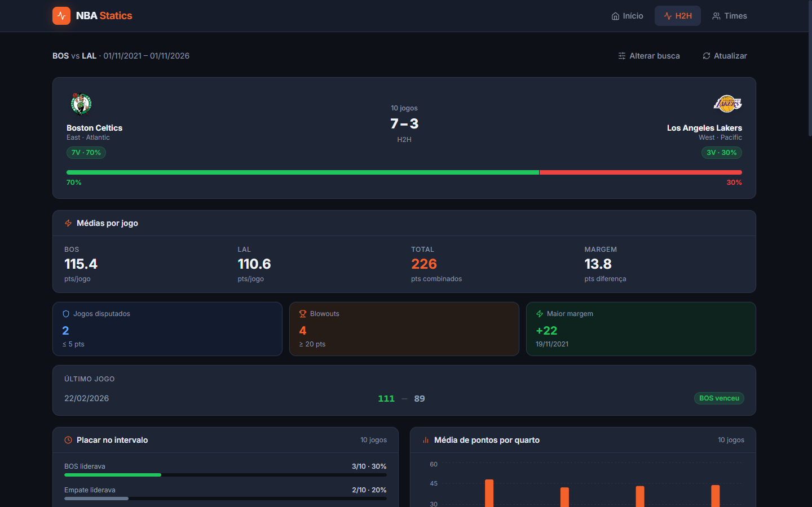

# Pedro Arthur Diniz

**Desenvolvedor Full Stack** · Node.js · TypeScript · React · Next.js · PHP/Laravel

Desenvolvo sistemas que precisam estar certos: notas fiscais, faturamento e pagamentos de um provedor de internet, rodando em produção com mais de 50 mil documentos por mês.

## O que já entreguei

- **NFS-e Nacional em PHP:** módulo que emite mais de 50 mil notas por mês, com assinatura digital do XML (certificado A1), integração REST com a API fiscal e emissão automática agendada.
- **NFCom em Node.js:** evolução do microsserviço que emite mais de 50 mil notas por mês, com gerador de DANFE e cálculo de PIS/COFINS, CBS e IBS.
- **Faturamento de ERP:** regras de um ERP que gera mais de 50 mil faturas por mês (juros, multa, dias proporcionais e boletos).
- **Portal de vagas de emprego:** construído desde o início, do front-end em Next.js ao back-end em Node.js com Clean Architecture.

> Os sistemas da empresa são privados. Abaixo está um projeto pessoal com o código aberto.

## Projeto em destaque: NBA Statics

Estatísticas da NBA com dados ao vivo: confrontos H2H entre times, elencos, perfil de jogadores e agenda de jogos.

| Repositório | Stack |
|---|---|
| [nba-statics-api](https://github.com/PedroADiniz/nba-statics-api) | Node.js · TypeScript · Express.js · Prisma · Clean Architecture · Docker |
| [nba-statics-front](https://github.com/PedroADiniz/nba-statics-front) | Next.js 14 (App Router) · React · TypeScript · Tailwind CSS |

## Tecnologias

- **Back-end:** PHP · Laravel · Node.js · TypeScript · Express.js
- **Front-end:** React · Next.js · JavaScript · Tailwind CSS · HTML · CSS
- **Banco de dados:** MySQL · Prisma · Knex.js
- **APIs e arquitetura:** REST · SOAP · XML · Swagger · Clean Architecture · Microsserviços
- **Infra e ferramentas:** Docker · Kubernetes · Linux · Git
- **IA no dia a dia:** ChatGPT

---

**English:** Full Stack Developer (Node.js, TypeScript, React, Next.js, PHP/Laravel) building tax and billing systems that handle 50,000+ documents per month in production.
